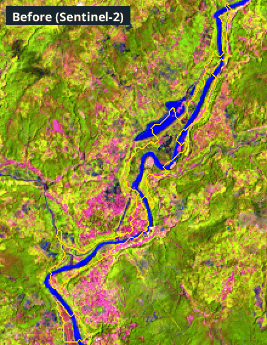
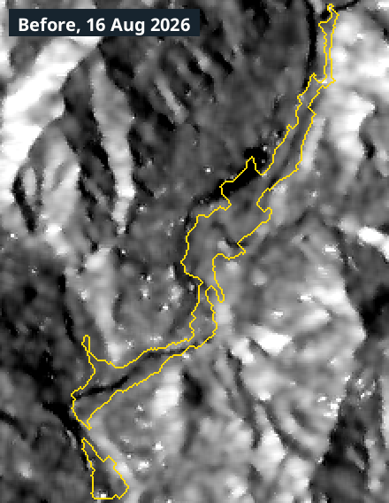

# FloodSight — flood damage mapping from space

**Multimodal AI Hackathon 2026 · Track B: Mapping Flood Damage from Space**

Give FloodSight an area and a flood date. It finds matching Sentinel-1 radar images from before and after,
maps new flood water and debris, overlays pre-event OpenStreetMap buildings, roads and bridges, and works out
which settlements have lost their road connection to a hospital. It then produces a map dashboard and a one-page
situation report in English and Nepali.

It runs end to end from Level-1 satellite data for **any area and date**, with no manual steps and nothing tuned to
one valley.

> Educational prototype. Not an operational emergency tool.

## Live demo

**https://floodsight.calmcliff-1848a7e4.eastasia.azurecontainerapps.io**

- **Open to everyone, no code:** the finished analyses (Trishuli case study, Crete, Buner, Sri Lanka, Slovenia) and the offline demo.
- **New analysis of any area and date:** needs the judges' access code, which is given to the judges with the submission (never published here).
- The first visit after a quiet period takes 1-3 minutes while the server starts; a new analysis takes about 5-10 minutes.
- Each connection can run 5 new analyses on the team's Copernicus account; after that, use your own free keys
  (see [Public demo server](#public-demo-server-limits-and-your-own-keys)).


## What you will see in the web app

| Page or tab | What it shows |
|---|---|
| **New analysis** | Draw a box on the map, pick the flood date, press Analyse. On the public server: the access code, and optionally your own Copernicus keys |
| **Progress** | Each stage with its time, and every satellite and map request live (service, seconds, megabytes, processing units, waits for busy servers) |
| **Overview** | The verdict (flood detected / possible flood / no significant change), confirmed key numbers with "+ possible", whether the area was checked against a reference map, and the settlements to reach first |
| **Map views** | Final map, AI alone, radar rules alone; layers for flood water, debris, radar-blind areas, roads cut, settlements and hospitals (each can be hidden) |
| **Cut off** | Every settlement with its access status (cut off, likely, unknown, detour, unchanged), travel time before and now, priority, and helicopter landing candidates; CSV download |
| **Before / after** | Radar and Sentinel-2 close-ups before and after the event, with the detection outlined in yellow: flicker, slide or side by side |
| **AI model** | What the AI added, confirmed and questioned on this area, its own probability map, and a link to the full model page (how it was trained and tested) |
| **Flow path** | Click any point to trace where water flows downstream, with settlements, hospitals and bridges along the way |
| **Report** | The one-page situation report (English; also Nepali for areas in Nepal) and CSV / GeoTIFF / GeoJSON files |
| **Validation** | For the checked example runs: comparison with the Copernicus EMS map (precision, recall, overlap, road closures) |
| **Method** | Settings, images used, and every data request of this run |

### See the change yourself: the before/after flicker

The **Before / after** tab switches between the image before the flood and the image after it, once a second.
**Whatever jumps is what changed.** The yellow line is what FloodSight detected, so you can check by eye whether
the change and the detection match. Trishuli valley, Nepal:

| Sentinel-2 (optical, false colour) | Sentinel-1 (radar) |
|---|---|
|  |  |

**How to read the optical picture** (false colour: short-wave infrared, near-infrared, red):
- **green** = vegetation; **pink to brown** = bare soil, fresh mud or debris; **dark blue to black** = water
  (muddy river water looks blue); **hatched grey** = clouds, no clear view.
- What to look for: green slopes and river banks that turn **pink** after the flood are fresh debris and landslide
  scars; a river that gets **wider and bluer** carried more water and sediment.

**How to read the radar picture** (Sentinel-1 sees through clouds, day and night):
- **dark** = smooth surfaces such as calm water; **bright** = rough surfaces such as rocks, debris or buildings.
- What to look for: ground that turns **dark** is new standing water; ground that turns **brighter or more
  speckled** is new debris. Where nothing jumps, the radar saw no change, which is why some debris is missed
  (see Limitations).

The animations show the run's own close-up pictures; nothing is edited. Make them for any run with
`python scripts/make_flicker_gif.py <run>`.

Full numbers and test types: [docs/results.md](docs/results.md). Report: 6 pages, with limitations.

---

## Quick start (5 minutes, no accounts)

```bash
pip install -r requirements.txt
python serve.py                        # opens http://127.0.0.1:8000
```

In the app, choose **Run the offline demo valley** (about 15 s), or from the command line: `python run.py --demo`.

The demo valley reproduces the brief's "Who is cut off?" figure: the expected answer (villages B, C, E and
Riverside Bazar cut off; A and D still connected) is checked by the test suite (`pytest`).

## Real data

1. **Create a free account** at [dataspace.copernicus.eu](https://dataspace.copernicus.eu).
2. `cp .env.example .env` and fill in `CDSE_USERNAME` / `CDSE_PASSWORD`. For fast processing also create an OAuth
   client (CDSE Sentinel Hub dashboard → User settings → OAuth clients) and add `SH_CLIENT_ID` / `SH_CLIENT_SECRET`.
3. Check the machine: `python scripts/check_setup.py --login` (opens the openEO login once; the token is cached).
4. Run:

```bash
python run.py --bbox 85.10,27.88,85.45,28.25 --date 2026-08-26     # Trishuli case study
```

or use the web app (`python serve.py`): draw a box on the map (or type its corners, or pick a known flood), set the
date and press **Analyse this area**. Results are in `runs/<run_id>/`.

### Windows laptop (RTX 50-series) setup

```powershell
conda create -n floodsight python=3.11 -y
conda activate floodsight
pip install -r requirements.txt
# PyTorch with CUDA 12.8+ (required for RTX 50-series), for the model only:
pip install -r requirements-gpu.txt
```

---

## What it produces

| Output | Where |
|---|---|
| Map dashboard: flood/debris overlay with confidence, radar blind spots, hit roads/bridges/buildings, settlements by road-access status, hospitals, before/after swipe on the map, flow-path tool, validation | `python serve.py` |
| One-page situation report, English + Nepali (PDF) | `runs/<id>/report/situation_report_{en,ne}.pdf` |
| Every number, inputs used, caveats, timings | `runs/<id>/results.json` |
| GeoTIFF layers (class, confidence) and GeoJSON vectors | `runs/<id>/layers/`, `runs/<id>/vectors/` |
| Comparison with a reference map (EMSR927) | `runs/<id>/validation/` |

Flood classes: `1` new flood water · `2` debris / mud · `3` permanent water · `255` radar blind / no image.
Confidence `1–3` per flood/debris pixel.

---

## How it works

```
area + date
  │
  ├─ Catalogue search (Copernicus OData) ─► pick best BEFORE/AFTER pair on the SAME orbit track
  │                                          (up to 2 tracks, e.g. ascending + descending)
  ├─ Sentinel-1 GRD ─► Sentinel Hub on CDSE: calibrated sigma0, orthorectified, cropped to the area
  │                    (fallbacks: openEO sigma0 on CDSE, then local processing of the Level-1 GRD file;
  │                     all three deliver the same calibration, so a fallback does not change results)
  ├─ Sentinel-2 L2A ─► cloud-masked before/after composites (used only where clear)
  ├─ Copernicus DEM ─► slope, drainage, HAND, radar layover/shadow for this orbit geometry
  └─ OpenStreetMap @ day before the event (ohsome API) ─► buildings, roads, bridges, villages, hospitals
        │
        ▼
  Rule-based change detection (always runs)          Siamese U-Net (Kuro Siwo), if weights present
   • water: scene-adaptive threshold + ≥3 dB drop     • pre/post radar + slope, shared encoder
   • debris: VV/VH change + texture, near river,       • probability of flood water
     only in mountain terrain (UNEP-WCMC definition)
   • HAND / slope / blind-spot filters
        └──────────────► fusion (tracks + model + optical) ─► class + confidence map
                                   │
                  ┌────────────────┼─────────────────┐
             damage overlay   road graph before/after   flow path (bonus)
                  └────────────────┼─────────────────┘
                                   ▼
                     results.json ─► dashboard + PDF reports
```

### Bonus: flood path from any point

Click any point on the map (Flow path tab), also outside the analysed box, e.g. a glacial lake upstream, or run
`python -m floodsight.analysis.flowtrace --lon 85.36 --lat 28.27 --km 80 --date 2026-08-26`.
The path is traced window by window on the Copernicus DEM GLO-30 at 30 m (D8 steepest descent after filling
pits and depressions), so it continues down the valley beyond the box. Along it, from pre-event
OpenStreetMap: settlements, health facilities and bridges with km downstream, distance from the river and
height above it; valley-floor bands up to 10 / 25 / 50 m above the river (exposure levels, not a depth
forecast); an elevation profile; whether damage was detected near each place in the current analysis; and a
check of the path itself (share of its length on a river mapped in OpenStreetMap).

### Design choices for correct results

- **Same-track pairs only.** Images from different tracks see terrain from different angles and cannot be
  compared pixel by pixel, so the tip in the brief is enforced in code (`fetch/catalog.py: select_pairs`).
- **Scene-adaptive water threshold.** Chosen from tiles whose radar histogram is clearly bimodal (split-based
  Otsu), clamped to physical limits. No threshold is tuned to Trishuli.
- **Mountain false-alarm filters.** HAND (height above nearest drainage) and slope limits, plus a computed
  layover/shadow mask. Blind pixels are reported as *unknown*, never as *safe*.
- **Debris, not just water.** Debris flows brighten or roughen the radar return rather than darken it. They are
  detected separately and must connect to the river corridor.
- **"No flood" is a valid answer.** If new water plus debris is under 0.05 km², the verdict is
  *no significant change*. The rehearsal script includes a dry-season control case.
- **Escape routes beyond the map.** Roads and hospitals are fetched 15 km beyond the area, so a village is not
  reported cut off just because its route leaves the box.
- **Numbers cannot be invented.** Reports are fixed templates filled from `results.json`. No language model is
  in the reporting path.

### Processing the raw satellite data

FloodSight has its **own processing chain from the raw Sentinel-1 Level-1 GRD product** (`floodsight/fetch/s1_local.py`,
`--backend local`, or "Process raw GRD on this computer" in the app):

1. download the GRD measurement, annotation, calibration and noise files from the Copernicus Data Space (free account);
2. read only the window of the swath that covers the area;
3. **thermal-noise removal** with the product's own range and azimuth noise LUTs;
4. **radiometric calibration** to sigma0 with the product's sigmaNought LUT;
5. **geocoding** with the product's geolocation grid, plus a **terrain (parallax) correction** with the Copernicus DEM;
6. resampling onto the analysis grid; speckle filtering (Lee) is then done in FloodSight's detection step.

The same steps can be run on Copernicus servers instead (Sentinel Hub, then openEO), which is faster for a live
demo because only the cropped area is transferred. Those services also start from Level-1 GRD and return only
calibrated VV/VH backscatter, never a water or flood product; every detection is made by FloodSight's code. Each
run records which route processed each image (`results.json`, Method tab). `scripts/compare_backends.py` runs the
same area both ways and reports how closely the backscatter and the flood maps agree.

### Public demo server: limits and your own keys

On the public link (`FLOODSIGHT_PUBLIC=1`) finished analyses and the offline demo are open to everyone. A new
analysis needs the judges' access code and runs on the team's Copernicus account, with limits so the free quota
is not exhausted: at most `FLOODSIGHT_RUNS_PER_IP` (default 5) new analyses per visitor address, plus daily caps
(`FLOODSIGHT_MAX_RUNS_DAY`, `FLOODSIGHT_PU_DAY`). Re-opening or re-running an area that was already analysed is free.

Visitors can instead enter **their own Sentinel Hub keys** ("Use my own Copernicus keys") and then are not limited
by our quota. The keys are used for that one analysis only, kept in memory while it runs and then forgotten; they
are never saved, logged or returned, and that run uses only the visitor's account (no fallback to ours). We never
ask for an account password. When our account reaches a limit, the app says so and opens the own-keys form.

How to get your own keys (free, about 3 minutes): create an account at https://dataspace.copernicus.eu, open the
Sentinel Hub dashboard, go to **User settings, OAuth clients, Create**, and copy the client ID and the client
secret (the secret is shown only once). Paste both into "Use my own Copernicus keys" on the New analysis page,
together with the access code. You can delete the client in your account afterwards.

### Latency

- Only the valley is transferred: openEO processes on Copernicus servers and returns a cropped GeoTIFF.
- DEM, OSM and Sentinel-2 download in parallel; both Sentinel-1 dates are processed concurrently.
- Every input is cached per run: re-running an area is near-instant (useful for demos).
- 20 m grid by default: a 1,500 km² valley is about 4 M pixels. Per-stage timings are in `results.json` and
  the dashboard's *Run details* tab.

---

## Data rules (from the brief) and how they are enforced

| Rule | Enforcement |
|---|---|
| Inputs only: Sentinel-1/2, Copernicus DEM, pre-event OSM, listed training data | Only these fetchers exist |
| OSM must be pre-event | Snapshot = min(day before flood, latest ohsome date); asserted in `core.osm_snapshot_date`. Fetched from the ohsome API only (v2 with key, else v1), as the brief specifies; an Overpass *attic* fallback exists but is off (`osm.overpass_fallback: false`) |
| EMS / UNOSAT / other damage maps only for checking | `core.assert_allowed_input` refuses such paths; only `floodsight/validate/` opens them; `tests/test_rules.py` fails if any pipeline module imports it |
| Run end to end from raw data for any area/date | `run.py` needs only a box and a date; local GRD processing proves the chain from Level-1 |
| Place search is navigation, not an input | "Find a place" (dashboard) and `run.py --place` ask Nominatim (OpenStreetMap geocoder) for a place's location to propose a box; nothing from it enters the analysis, and the operator confirms/adjusts the box |

---

## AI component: flood segmentation model

Siamese U-Net (shared ResNet-34 encoder, fused `[post, |post − pre|]` features, 3 classes) trained on
**Kuro Siwo**.

```bash
# 1. download Kuro Siwo (see its GitHub README), then check labels once:
python -m floodsight.model.dataset --inspect D:/data/KuroSiwo
# 2. train (8 GB GPU): hold out whole events, never random tiles
python -m floodsight.model.train --root D:/data/KuroSiwo --epochs 15 --batch 8 --workers 4 --pretrained \
       --val-events <event> --test-events <2 events> --max-per-event 5000
# 3. re-score any events later (one row per event + combined)
python -m floodsight.model.evaluate --root D:/data/KuroSiwo --weights models/siamese_unet.pt --events <ids>
# -> models/siamese_unet.pt (picked up automatically), .history.json, .test.json
```

"Works on Himalayan scenes it has never seen" is shown by running the full pipeline on Trishuli (and the other
presets) and comparing with EMSR927. The model never trained on these events. The dashboard and report say
whether the model was used, and the rule-based map always runs as a baseline for comparison.

## Case study: compare with EMSR927

Download the EMSR927 packages (zip files) from the Copernicus EMS activation page
(<https://rapidmapping.emergency.copernicus.eu/EMSR927>) into `validation_data/EMSR927/`, then:

```bash
python run.py --bbox 85.08,27.85,85.40,28.29 --date 2026-08-26 --name trishuli_case
python -m floodsight.validate.ems --inspect validation_data/EMSR927            # what is inside
python -m floodsight.validate.ems --run runs/trishuli_case --ems validation_data/EMSR927
```

For each EMS area (Syapru Besi, Timure, Bidur, …) it reports flood/debris extent IoU, F1, precision and
recall, the share of each EMS event type we detected, building-damage recall/precision and damaged-road
coverage, with an agreement map. It also appears in the web app's *Validation* tab. Pixels the radar could
not see are excluded and reported separately. **EMSR927 is never used to tune the system**: thresholds are
set on other events so that Trishuli stays an unseen test.

## Rehearse the live evaluation

```bash
python scripts/rehearse.py             # Trishuli, Teesta 2023, Melamchi 2021, Beas 2023 + dry-season control
python scripts/rehearse.py --demo      # offline sanity check
```

This prints a PASS/FAIL scorecard with timings. Run it every few days and before judging.

---

## Limitations

The full, maintained list with measured numbers is in [docs/limitations.md](docs/limitations.md). In short:

- **No early warning.** Sentinel-1 revisits every few days (6–12 at a given track), so the system maps impact
  after the fact and cannot warn of a glacier collapse or lake outburst minutes ahead.
- **Radar blind spots.** Steep slopes facing toward or away from the satellite (layover/shadow) cannot be
  measured. They are shown as unknown. A second orbit track and clear-sky Sentinel-2 fill some of them.
- **Debris vs. other change.** Fresh landslides, construction or harvested fields near the river can look like
  debris. The river-corridor rule reduces this but does not remove it.
- **Narrow rivers.** At 20 m (10 m native) resolution, channels only a few pixels wide are hard to map.
- **OSM completeness.** Buildings, roads and health facilities in remote valleys are often incompletely mapped.
  Cut-off status is only as good as the mapped road network, and footpaths are excluded by default.
- **Timing of the "after" image.** Water may have receded by the first post-event pass; debris persists.
- **Model domain gap.** Kuro Siwo has few steep Himalayan scenes; the model is fused with, not substituted for,
  the physically constrained rules.
- **Own GRD chain uses simpler geocoding.** It uses the product's GCP grid with a DEM parallax correction rather than
  precise-orbit range-Doppler terrain correction, and downloads whole measurement files (slower than the servers).

## Web app and system design

```
 browser (React + Leaflet, web/dist)                       python serve.py  (FastAPI + uvicorn, one process)
 ┌──────────────────────────────┐   POST /api/jobs         ┌───────────────────────────────────────────────┐
 │ draw area · date · Analyse   │ ───────────────────────► │ validate input (bbox, date range, area limit)  │
 │ numbered progress + log      │ ◄─── GET /api/jobs/<id>  │ job queue ─► ONE worker thread ─► pipeline.run │
 │ map: layers = legend, swipe  │      (poll every 1.5 s)  │   progress callbacks + log lines into the job  │
 │ cut-off list, flow path,     │ ◄─── GET /api/runs/<id>  │ runs/<run_id>/ results.json, PNG, GeoJSON, PDF │
 │ report, validation, method   │ ◄─── /files/<path>       │ POST /api/runs/<id>/flow (any point, job)      │
 └──────────────────────────────┘                          └───────────────────────────────────────────────┘
```

- **One analysis at a time, queued.** The pipeline already downloads in parallel, and Copernicus openEO allows only a
  couple of concurrent requests per account; two analyses at once would both be slower and risk rate limits.
- **Idempotent.** The same area + date + settings while queued or running returns the same job (a double click or a
  reload never starts a second download). A finished identical analysis is offered to open instantly, or to re-run
  with every downloaded input reused from the cache.
- **Progress by polling,** not sockets: survives page reloads, sleep and proxies. The URL (`#/job/<id>`,
  `#/run/<id>`) keeps the screen on reload and makes a result linkable.
- **Failure is a state, not a crash.** "No usable satellite images", "check the area and date" and unexpected errors
  come back as plain sentences; the server keeps running.
- **Security.** Binds to `127.0.0.1` by default (`--host 0.0.0.0` to show it on a projector or phone on the same
  network). Credentials stay in `.env` on the server; the browser only sees yes/no checks. Files are served only from
  inside the run folder, only known types; run names are limited to letters, digits, `-` and `_`.
- **No build tools needed to run.** `web/dist` is committed. To change the UI: `cd web && npm install && npm run dev`
  (hot reload on :5173, API proxied to :8000), then `npm run build`.
- API docs: <http://127.0.0.1:8000/api/docs>.

## Required attributions

- Contains modified Copernicus Sentinel data 2026.
- Produced using Copernicus WorldDEM-30 © DLR e.V. 2010–2014 and © Airbus Defence and Space GmbH 2014–2018
  provided under COPERNICUS by the European Union and ESA; all rights reserved.
- © OpenStreetMap contributors (ODbL). Place search: Nominatim (fallback Photon by komoot), OpenStreetMap data.
- Kuro Siwo: Bountos, N. I., et al. (2024). *Kuro Siwo: 33 billion m² under the water. A global multi-temporal
  satellite dataset for rapid flood mapping.* NeurIPS Datasets and Benchmarks.
- Reference maps (validation only): European Union, Copernicus Emergency Management Service data (EMSR927).
- Fonts: Noto Sans and Noto Sans Devanagari, SIL Open Font License.

## Repository layout

```
run.py                     CLI entry point
config.yaml                all parameters (generic, not tuned per valley)
floodsight/
  core.py                  config, grid, raster I/O, run folders, data-rule guards
  pipeline.py              orchestration, fusion, results.json
  fetch/                   catalog.py (search + pair selection), s1.py (Sentinel Hub / openEO / local), shub.py,
                           s1_local.py (GRD), s2.py, dem.py, osm.py (ohsome API),
                           geocode.py (place name -> proposed box; navigation only)
  preprocess/              geometry.py (layover/shadow, incidence), terrain.py (HAND, flow direction),
                           mountain.py (UNEP-WCMC mountain terrain: where debris is possible)
  detect/                  baseline.py (water + debris rules), fuse.py
  model/                   net.py, dataset.py, train.py, infer.py, metrics.py
  analysis/                damage.py, network.py (cut-off), landing.py (helipads + candidate landing ground),
                           flowtrace.py (bonus: flood path from any point)
  report/                  sitrep.py (EN/NE PDF), mapfig.py, exports.py, fonts/
  validate/ems.py          Copernicus EMS comparison per AOI: extent, buildings, roads, road-closure precision
  validate/misses.py       why EMS-mapped area was missed (blind, no radar change, weak change, filters)
  synthetic.py             demo/test valley
  presets.py               rehearsal areas
serve.py                   web app launcher
server/                    api.py (FastAPI routes), jobs.py (queue, progress, errors)
web/                       React + Leaflet app (src/), built copy in dist/
scripts/                   check_setup.py, rehearse.py, preview_run.py, preview_tiles.py,
                           check_domain.py + check_terrain.py (training-data vs case-study diagnostics)
tests/                     web API, detection, mountain gate, cut-off certainty, pair selection, data rules,
                           geometry, EMS validation, end-to-end
docs/                      tuning log, experiments (incl. rejected ones), report skeleton, judging-day checklist
Dockerfile, deploy/        free public deployment (Hugging Face Spaces), see deploy/README.md
```